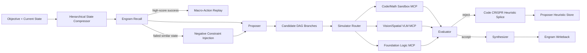

# Advanced Cognitive Harness

## Updated DAG Schema

## Data Structures

- **Engram**: persistent trajectory record containing objective, initial state, title, success/failure kind, score, risk, vector, actions, and lesson.
- **Memory Recall**: similarity-ranked hits plus negative constraints; high-score success becomes a cached macro-plan.
- **Simulator Route**: `{ domain, mcpServer, confidence, reason }`.
- **Compressed State**: `{ summary, affectedVariables, droppedTokenEstimate }`.
- **Heuristic Patch**: evaluator critique converted into a proposer rule and persisted for later prompt injection.

## MCP Routing Logic

The router classifies each proposed step before world simulation:

- `code`: routes to `secure-sandbox-mcp`
- `math`: routes to `math-execution-mcp`
- `spatial` / `visual`: routes to `vision-language-simulator-mcp`
- `logic` / `general`: routes to `foundation-logic-mcp`

The current implementation records the route and includes it in the world-model prompt. The next production step is to bind each MCP route to an actual adapter so code/math predictions can execute deterministically rather than relying on language simulation.

## Learning Loop

Rejected trajectories produce evaluator critiques. The splicing function turns those critiques into durable proposer heuristics, dedupes matching rules, and increases confidence when the same lesson recurs. Future runs inject relevant heuristics before plan generation.
